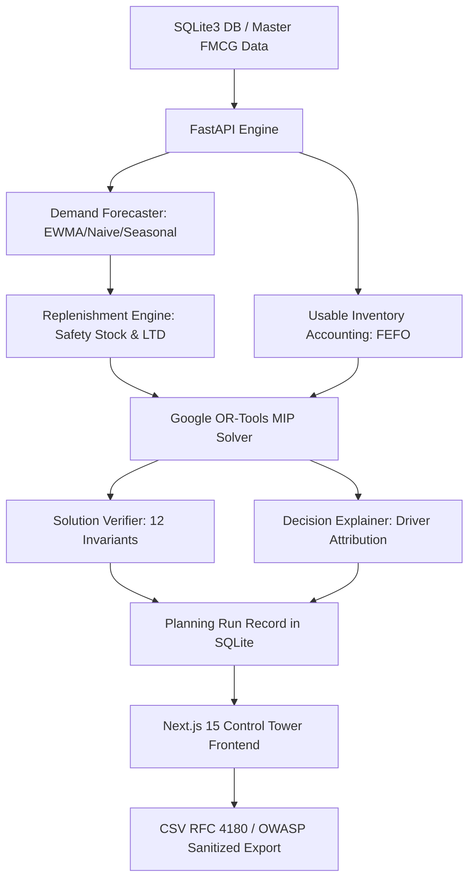

# StockWise AI — Hackathon Demonstration & Business Validation Guide

> **Triwizathon Problem Statement 2**: AI-Powered FMCG Distribution Intelligence and Inventory Optimization Engine.  
> **Repository**: [https://github.com/LSTAKI/ruk-pr.git](https://github.com/LSTAKI/ruk-pr.git)  
> **Architecture**: Local-First, Next.js 15 App Router, FastAPI, SQLite3, Google OR-Tools MIP.

---

## A. Project Summary

Fast-Moving Consumer Goods (FMCG) distribution networks face a multi-variable operational dilemma every morning:
1. **Perishable Batches & Expiry (FEFO)**: Shipping products from distant hubs risks product expiration before customer purchase.
2. **Stockout Urgency**: Retail store shelves empty quickly under Poisson daily demand spikes.
3. **Logistics Cost Escalation**: Expedited deliveries and fragmented LTL shipments rapidly erode FMCG operating margins.

**StockWise AI** is an enterprise-grade distribution control tower that replaces heuristic guesswork and manual spreadsheets with:
* Deterministic time-series forecasting across 800 corridors (Naive, EWMA, Seasonal Naive) with chronological holdout backtesting.
* Dynamic multi-echelon safety stock and reorder thresholding.
* Constraint-aware Mixed-Integer Linear Programming (MIP) powered by Google OR-Tools.
* Multi-objective profile formulations: **Cost-First**, **Service-First**, and **Balanced**.
* An independent 12-invariant mathematical verification auditor.
* Driver-based natural language explanations for every shipment recommendation.

---

## B. System Architecture



### Module Responsibilities:
1. **Frontend (`apps/web`)**: Next.js 15 App Router with TanStack React Query v5, Recharts, and Tailwind CSS. Provides 7 interconnected control-tower tabs: Overview, Inventory Explorer, Demand Forecasting, Replenishment Planner, Optimizer Planner, Scenario Compare, and Planning History.
2. **Backend API (`services/api`)**: High-performance FastAPI server exposing typed Pydantic v2 schemas for inventory batches, demand history, forecasting, replenishment signals, planning runs, and scenario simulations.
3. **MIP Optimizer (`app.engine.optimize.optimizer`)**: Formulates the multi-commodity network flow problem with supply bounds, demand bounds, throughput limits, and lead-time cutoffs using Google OR-Tools.
4. **Independent Verifier (`app.engine.verify.verifier`)**: Validates 12 mathematical invariants (supply capacity, non-negativity, integer flow conservation, active route validity) completely outside the solver routine.
5. **Decision Explainer (`app.engine.explain.explainer`)**: Analyzes competing warehouse alternatives (freight rate differentials, transit lead times, stock availability) to produce human-readable planner justifications.

---

## C. Demo Setup & Local Startup

### 1. Prerequisites Check
Run the cross-platform environment verifier:
```bash
.venv\Scripts\python.exe scripts/verify_environment.py
```
*Expected: Python 3.11+, Node.js 18+, SQLite3 OK.*

### 2. Database Seeding (Seed: 42)
```bash
.venv\Scripts\python.exe scripts/seed_demo_data.py
```
*Expected: 4 warehouses, 16 products, 50 destinations, 200 routes, 158 inventory batches, and 96,000 demand history records seeded into `data/stockwise.db`.*

### 3. Launch Local Backend
In Terminal 1:
```bash
.venv\Scripts\python.exe -m uvicorn app.main:app --app-dir services/api --host 127.0.0.1 --port 8000 --reload
```
*Verify: Open `http://127.0.0.1:8000/api/v1/health` &rarr; `{"status": "ok", "database_connected": true}`.*

### 4. Launch Local Frontend
In Terminal 2:
```bash
cd apps/web
npm run dev
```
*Access: Open `http://localhost:3000` in Google Chrome or modern browser.*

---

## D. Step-by-Step Live Demonstration Script

| Step | Time | Navigation / Action | What to Highlight & Explain |
| :--- | :--- | :--- | :--- |
| **1. Application Shell & Health** | 0:00 - 0:30 | Open `http://localhost:3000` | Point out the **LOCAL-FIRST** badge, **Engine Online** indicator, and **Simulated FMCG v1.0** dataset tag. Emphasize zero external cloud dependencies. |
| **2. Inventory Accounting** | 0:30 - 1:00 | Click **Inventory Explorer** tab | Highlight the 4-tier accounting distinction: On-Hand vs. Reserved vs. Available vs. **Usable Stock**. Filter by `QUARANTINED` to prove that quarantined batches show **0 Usable units** and are excluded from allocation. |
| **3. Demand Forecasting** | 1:00 - 1:30 | Click **Demand Forecast** tab | Select Corridor `PRD-MILK` &rarr; `DST-001`. Select **EWMA** (&alpha; = 0.30) with a **7-day horizon**. Click **Generate Forecast**. Point out the Recharts curve showing historical demand actuals followed by forward projections. Click **Run Backtest Evaluation** to demonstrate holdout validation (MAE &amp; WAPE). |
| **4. Replenishment Risks** | 1:30 - 2:00 | Click **Replenishment** tab | Show the critical risk pairs and highlight the **Operational Model Notice (GAP-1 & GAP-2)** disclosing store-level inventory assumptions. Click **Details** on any row to open the mathematical driver explanation modal. |
| **5. OR-Tools Optimization** | 2:00 - 2:45 | Click **Optimizer Planner** tab | Select **Balanced** profile (7-day horizon). Click **Run Local Optimizer**. Point out the **OPTIMAL** status card, runtime (<0.5s), **Verifier: Feasible** badge, and shipment recommendation table. Expand a row to show the driver-based rationale explaining why alternatives were rejected. |
| **6. Scenario Trade-offs** | 2:45 - 3:30 | Click **Scenario Compare** tab | Click **Run Scenario Comparison**. Show the comparative matrix across **Cost-First**, **Balanced**, and **Service-First**. Point out the empirical trade-off: Cost-First saves freight ($50,150.99), while Service-First maximizes customer fulfillment (91.74%). Point out that Expiry Waste is honestly labeled **Not Modeled**. |
| **7. Planning History & Export** | 3:30 - 4:00 | Click **Planning History** tab | Show the audit trail of persisted runs. Click **Inspect** to review past shipments. Click **Download Run CSV** and open the exported file to demonstrate RFC 4180 formatting, metadata headers, and OWASP formula injection neutralization. |

---

## E. Empirical Validation Results & Benchmark Methodology

### 1. Demand Metric Definition & Decomposition
The benchmark demand of **39,878 units** represents the multi-echelon replenishment threshold computed over all 800 corridors (50 destinations &times; 16 products):
$$\text{Corridor Demand}_{d,p} = \lceil \text{LeadTimeDemand}_{d,p} + \text{SafetyStock}_{d,p} - (\text{OnHand}_{d,p} + \text{InTransit}_{d,p}) \rceil$$
Under the active operational data gaps (**GAP-1** store on-hand $= 0$ and **GAP-2** in-transit $= 0$), this simplifies to:
$$\text{Corridor Demand}_{d,p} = \lceil \text{LeadTimeDemand}_{d,p} + \text{SafetyStock}_{d,p} \rceil$$
* **Total Lead-Time Demand**: $\sum \text{LTD} = 28,745.44 \text{ units}$ (daily mean &times; route lead time in days).
* **Total Safety Stock**: $\sum \text{SS} = 10,744.93 \text{ units}$ ($z \times \sigma \times \sqrt{L}$, where $z = 1.65$).
* **Continuous Sum (LTD + SS)**: $39,490.36 \text{ units}$.
* **Discrete Integer Sum ($\sum \lceil \text{LTD} + \text{SS} \rceil$)**: **39,878 integer units** (integer ceiling adds $+387.64 \text{ u}$ over 800 corridors, $+0.48 \text{ u/corridor}$).

### 2. Empirical Performance Matrix

The following metrics were measured on the deterministic seed `42` dataset (`v1.0-seed-42`, 7-day horizon, 39,878 units total replenishment demand considered):

| Metric | Cost-First Profile | Balanced Profile | Service-First Profile | Deterministic Greedy Baseline |
| :--- | :---: | :---: | :---: | :---: |
| **Solver Status** | `OPTIMAL` | `OPTIMAL` | `OPTIMAL` | Deterministic Heuristic |
| **Total Demand Considered** | 39,878 u | 39,878 u | 39,878 u | 39,878 u |
| **Fulfilled Units** | 35,963 u | 36,583 u | 36,583 u | 36,583 u |
| **Unmet Demand Units** | 3,915 u | 3,295 u | 3,295 u | 3,295 u |
| **Demand Reconciliation** | $35,963 + 3,915 = 39,878$ | $36,583 + 3,295 = 39,878$ | $36,583 + 3,295 = 39,878$ | $36,583 + 3,295 = 39,878$ |
| **Network Fulfillment Rate** | **90.18%** | **91.74%** | **91.74%** | **91.74%** |
| **Total Transportation Cost** | **$50,150.99** | **$52,816.51** | **$52,812.09** | **$54,085.66** |
| **Average Cost / Fulfilled Unit** | **$1.3945 / u** | **$1.4437 / u** | **$1.4436 / u** | **$1.4784 / u** |
| **Recommended Shipment Lines** | 764 lines | 774 lines | 774 lines | 774 lines |
| **Destinations Served** | 50 / 50 | 50 / 50 | 50 / 50 | 50 / 50 |
| **Solver Runtime** | 0.39s | 0.20s | 0.43s | < 0.05s |
| **12-Invariant Verifier** | `FEASIBLE` (12/12) | `FEASIBLE` (12/12) | `FEASIBLE` (12/12) | `FEASIBLE` (12/12) |

### 3. Explicit Mathematical Formulas
* **Fulfillment Rate**: $\text{Rate} = \frac{\text{Fulfilled Units}}{\text{Total Demand Considered}} \times 100\%$
* **Average Freight Cost per Fulfilled Unit**: $\text{Avg Cost} = \frac{\text{Total Freight Cost}}{\text{Fulfilled Units}}$
* **Freight Cost Reduction vs. Baseline**: $\Delta \text{Cost} = \text{Baseline Freight Cost} - \text{Optimized Freight Cost}$
* **Percentage Reduction**: $\text{Savings \%} = \frac{\Delta \text{Cost}}{\text{Baseline Freight Cost}} \times 100\%$
* **Demand Conservation**: $\text{Fulfilled Units} + \text{Unmet Units} \equiv \text{Total Demand Considered}$

---

## F. Optimization vs. Greedy Baseline Analysis

### 1. Cost-First vs. Greedy Baseline
* **Freight Cost Reduction**: Cost-First achieves **$50,150.99** vs. Baseline **$54,085.66**, delivering an operational freight reduction of **-$3,934.67 (-7.27%)**.
* **Trade-off**: It deliberately trims 620 units (-1.56%) of long-haul, margin-diluting shipments while strictly satisfying the configured &ge; 80% fulfillment floor (delivering 90.18%).

### 2. Service-First vs. Greedy Baseline
* **Fulfillment Parity**: Both Service-First and the Greedy Baseline fulfill **36,583 units (91.74%)**, which represents the mathematical maximum allocatable supply across the network (the remaining 3,295 units cannot be fulfilled due to total physical stock exhaustion of SKU-0004).
* **Intelligent Routing Savings**: In Stage 2 of the lexicographic solve, Service-First optimizes routing across all eligible hubs without sacrificing a single unit of service, delivering **-$1,273.57 (-2.35%)** lower freight cost than the greedy heuristic ($52,812.09 vs. $54,085.66).

### 3. Balanced vs. Service-First
* **Freshness Lead-Time Penalty**: The Balanced profile incorporates a lead-time transit penalty ($0.20/day/unit), routing select shipments through faster transit corridors to preserve shelf life at a minor freight delta of +$4.42 across the entire network ($52,816.51 vs $52,812.09).

### 4. Independent Verifier Coverage (12 Invariants)

| Invariant | Description | Enforcement Level |
| :--- | :--- | :--- |
| **1. Non-Negative Shipments** | All allocated quantities $x_{w,d,p} > 0$ strictly. | Hard check |
| **2. Integer Allocations** | All recommended quantities are whole numbers ($x \in \mathbb{Z}^+$). | Hard check |
| **3. Usable Batch Status** | Expired or quarantined batches contribute 0 usable units. | Hard check |
| **4. Warehouse Supply Bound** | $\sum_d x_{w,d,p} \le \text{AvailableSupply}_{w,p}$ for every warehouse and SKU. | Hard check |
| **5. Demand Ceiling** | $\sum_w x_{w,d,p} \le \text{Demand}_{d,p}$ prevents destination over-allocation. | Hard check |
| **6. Active Route Validity** | Inactive or non-existent routes are completely excluded. | Hard check |
| **7. Dispatch Throughput** | $\sum_{d,p} x_{w,d,p} \le C_w^{\text{dispatch}}$ daily warehouse limit. | Hard check |
| **8. Receiving Throughput** | $\sum_{w,p} x_{w,d,p} \le C_d^{\text{receive}}$ daily destination limit. | Hard check |
| **9. Lead-Time Cutoff** | Transit lead time $L_{w,d} \le \text{Cutoff}$ days. | Hard check |
| **10. Batch Arrival Expiry** | Batch expiry date must exceed $\text{Arrival Date} + \text{Min Shelf Life}$. | Hard check |
| **11. Demand Reconciliation** | $\text{Fulfilled} + \text{Unmet} = \text{Total Demand}$ strictly across all corridors. | Hard check |
| **12. Cost Reconciliation** | $\sum (x_{w,d,p} \times c_{w,d}) = \text{Reported Transport Cost}$ within $\pm \$0.05$. | Hard check |

---

## G. Known Limitations & Architectural Disclosures

1. **Simulated FMCG Data**: Historical demand across 800 corridors is deterministically generated using day-of-week seasonality, Poisson daily orders, and normal lead times (seed: 42).
2. **GAP-1 (Store On-Hand Stock = 0)**: Retail destination store stock is currently not modeled in the database schema and is assumed to be 0 units.
3. **GAP-2 (In-Transit Dispatches = 0)**: Confirmed orders currently in transit are not tracked and treated as 0 units. Consequently, gross replenishment equals the full threshold (LTD + Safety Stock).
4. **Retail Expiry Waste Unmodeled**: Shelf-life expiry is enforced at warehouse sourcing via FEFO batch dates. Retail shelf expiry shrinkage is unmodeled due to lack of store POS turnover feeds and is explicitly labeled **Not Modeled**.
5. **Advisory Plan Disclaimer**: Optimization outputs represent advisory shipment schedules; generating a plan does not deduct physical inventory from warehouse batches.

---

## H. Troubleshooting & FAQ

| Problem | Root Cause | Verified Remedy |
| :--- | :--- | :--- |
| **"Backend Disconnected" badge on Navbar** | FastAPI backend is not running on port 8000 | Start backend: `.venv\Scripts\python.exe -m uvicorn app.main:app --app-dir services/api --port 8000` |
| **"Failed to load inventory batches"** | SQLite database file not found or unseeded | Run: `.venv\Scripts\python.exe scripts/seed_demo_data.py` |
| **`TARGET_UNACHIEVABLE` solver outcome** | Cost-First minimum fulfillment floor set higher than network capacity | Lower fulfillment floor slider (e.g. 80%) or check **Unconstrained Opt-In** checkbox |
| **`playwright test` timeout error** | Backend was not started prior to launching browser tests | Ensure backend is running at `http://127.0.0.1:8000` before executing `npx playwright test` |
